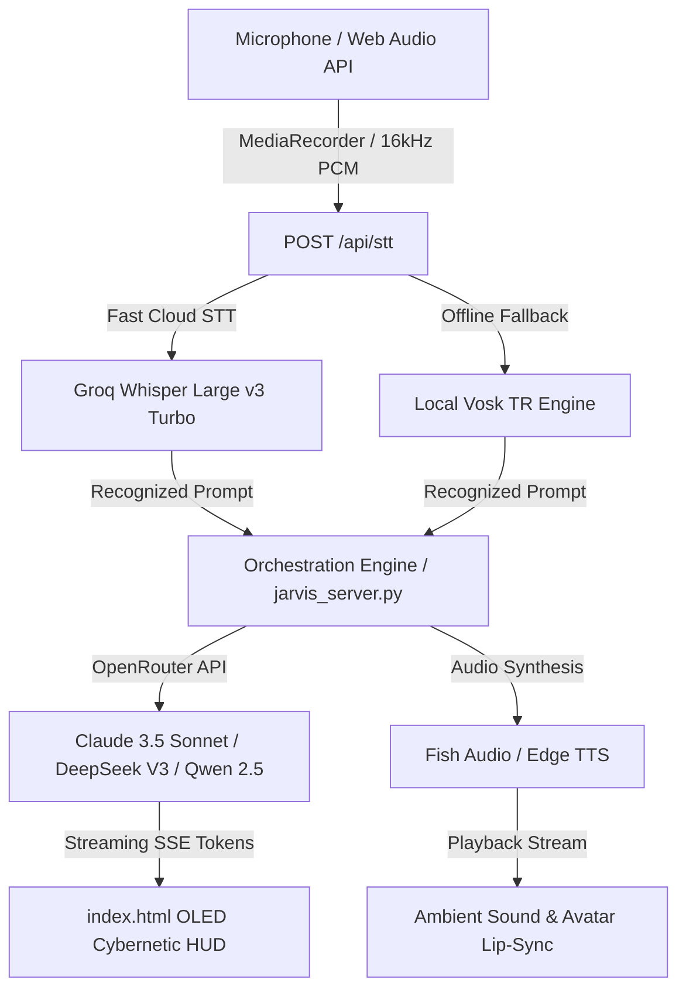

# Luna AI — Autonomous Cybernetic HUD & Real-Time Voice Assistant

<div align="center">


**Luna AI** is a lightweight, zero-dependency, local-first cybernetic desktop assistant and real-time voice HUD station built with Python FastAPI and an authentic glassmorphic interface.

[Quickstart](#quickstart) • [Architecture](#architecture) • [Features](#features) • [Directory Structure](#directory-structure) • [Contributing](#contributing)

</div>

---

## Architecture Overview



---

## Features

- **Cybernetic OLED HUD:** Pitch-black background (`#05080d`), responsive neon pulsing system indicator, clean single-page monolithic architecture.
- **Atmospheric Calm Rooms:** 6 calm study environments with Web Audio API soundscapes (rain, crackling fireplace, city night).
- **Dual-Engine Speech-to-Text (STT):**
  - **Cloud:** Sub-150ms transcription via Groq Whisper (`whisper-large-v3-turbo`).
  - **Local/Offline:** Vosk Turkish PCM engine powered by FFmpeg.
- **Fluid Voice Mode & Barge-In:** Real-time conversational loops with instant interruptibility.
- **Multi-Model Intelligence:** Configured for Anthropic Claude 3.5 Sonnet, DeepSeek V3/R1, and Qwen 2.5 via OpenRouter.
- **Autonomous Developer & Desktop Agent:** System diagnostic hooks, automated hardware telemetry radar, and task automation.

---

## Directory Structure

```text
luna-ai/
├── assets/                     # Media assets, screenshots, and artwork
│   └── screenshots/            # Dashboard & UI capture archives
├── docs/                       # Architecture specs, audit logs, and handover reports
│   ├── LUNA_AI_YONETICI_BRİFİNG_VE_PROMPT.md
│   └── ACCIO_SISTEM_VE_DEVIR_RAPORU.md
├── scripts/                    # Automation utilities, Windows launchers & patch scripts
│   ├── start_jarvis.bat
│   └── start_jarvis.ps1
├── static/                     # Web assets (avatars, soundscapes, audio files)
│   ├── avatars/                # Seated portraits and dynamic avatar sprites
│   └── audio/                  # Ambient sound reference audio
├── tests/                      # Regression, security, and integration test suite (50+ modules)
├── .clinerules                 # Local coding constitution for VS Code Cline agent
├── AGENTS.md                   # Multi-agent collaboration protocol (Accio, Claude, Manus, Cline)
├── CLAUDE.md                   # Strict surgical coding & token-conservation guidelines
├── jarvis_server.py            # Primary FastAPI / WebSocket async backend (Port 7860)
├── jarvis_local_stt.py         # Offline Vosk Turkish STT loopback worker
├── jarvis_voice.py             # Voice bridge and streaming audio controller
├── index.html                  # Cybernetic HUD frontend interface
└── README.md                   # Project documentation
```

---

## Quickstart

### Prerequisites
- Python 3.10+
- FFmpeg (added to Windows PATH)
- Node.js & npm (optional, for MCP & Claude Code tooling)

### 1. Clone & Setup
```powershell
git clone https://github.com/negr1v/luna-ai.git
Set-Location "luna-ai"
```

### 2. Configure Environment
Set your API keys inside `jarvis_config.json` or through the interactive in-app settings modal:
- `openrouter_api_key`: OpenRouter API key for Claude 3.5 Sonnet & DeepSeek.
- `groq_api_key`: Groq Cloud API key for ultra-fast Whisper STT.

### 3. Launch System
```powershell
.\start_jarvis.bat
```
Navigate to `http://127.0.0.1:7860` in any modern web browser.

---

## Key Bindings

| Key | Action |
| :--- | :--- |
| <kbd>V</kbd> | Toggle live voice mode / microphone loop |
| <kbd>R</kbd> | Replay last assistant voice response |
| <kbd>Esc</kbd> | Stop speaking / interrupt assistant audio (Barge-In) |

---

## License

This project is open-source and available under the [MIT License](LICENSE).
